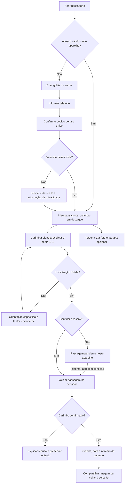

# Revisão do passaporte: jornada no celular, UI/UX e segurança

Data: 15/10/2026. Página: https://www.pistavivamototurismo.com.br/selo/passaporte.

## Decisão proposta

Dar prioridade a criar, acessar e carimbar. Personalização, coleções, mapa público e conteúdo institucional ficam como caminhos secundários. Preservar identidade de papel, carimbos e tipografia do passaporte; simplificar a interface que envolve essa identidade.

Objetivo de produto: visitante entender o benefício, criar seu passaporte e registrar a primeira cidade com pouca digitação. Usuário recorrente chegar à ação de carimbar sem atravessar apresentação ou editor.

## Escopo e limites da revisão

- Navegação pública em Chrome com toque e telas emuladas de 320, 390 e 430 px; capturas de tela, clique no botão inicial, inspeção de layout e recuperação.
- Nenhum cadastro, recuperação de conta real, upload ou check-in enviado. Requisições de escrita foram bloqueadas no contexto de auditoria.
- Revisão do código local de cadastro, recuperação, API, armazenamento, publicação, carimbos e modo offline. Código local tem mudanças ainda não publicadas; achados do código não equivalem a exploração comprovada em produção.
- 34 testes existentes selecionados passaram. `npm audit --omit=dev --json`: zero vulnerabilidades conhecidas em dependências de produção nesta consulta. Isso não prova ausência de falhas de aplicação.
- Não houve teste em aparelho físico, VoiceOver/TalkBack, Safari real, rede móvel real, acesso administrativo, revisão do banco de produção nem pentest.

## Evidências da página publicada

Em 390 × 844 px:

| Observação | Medição | Consequência |
| --- | --- | --- |
| Página completa longa | Aproximadamente 12.512 px | Muitas seções competem com a tarefa principal |
| Cadastro depois do editor demonstrativo | Título do cadastro em aproximadamente 9.594 px | Criar conta fica subordinado a testar imagem |
| Botão inicial | “Testar meu passaporte · grátis” aponta para `#meu-passaporte` | Pula conteúdo institucional, mas ainda chega à demonstração antes do cadastro |
| Após tocar no botão inicial | Cadastro ainda começa aproximadamente 2.710 px abaixo da viewport, cerca de 3,2 alturas de tela | Mesmo com o atalho, a criação fica depois de uma sequência longa de demonstração |
| Título do cadastro | 48 px; quatro linhas em 390 px | Ocupa 192 px antes dos campos |
| Link de recuperação | Cerca de 25 px de altura | Alvo menor que a meta de conforto proposta |
| Zoom do mapa | 30 × 30 px | Exige mais precisão no toque |
| Navegação do passaporte | “Conquistadores” começa em x=339 e termina em x=480 | Item parcialmente fora da faixa visível; barra exige rolagem lateral |
| Navegação global | Barra inferior com Início, Planejar, Agenda, Comunidade e Mais | Ocupa área permanente sem dar acesso direto a carimbar |
| Resumo público | 1 passaporte, 0 carimbos, 0 cidades, 0 estados | Neste estágio, priorizar instrução de uso em vez de números como prova social |
| Transferência observada | Cerca de 2,5 MB; 107 recursos | Adiar mapa e editor pode reduzir custo inicial; medição não representa 4G nem Core Web Vitals de campo |

Não houve transbordamento horizontal do documento nas três larguras. A barra interna de navegação continua precisando de rolagem horizontal. Campos principais já têm tamanho de fonte adequado; problema central é ordem, densidade e acesso à ação.

O código local de `app/selo/passaporte/page.jsx:69` já move a área do passaporte para perto do topo. Essa mudança não apareceu na página publicada durante a revisão. Mesmo localmente, `GeradorPassaporte.jsx:66` mantém demonstração antes do cadastro.

## Jornada atual

| Pessoa / situação | Caminho atual | Atrito |
| --- | --- | --- |
| Primeiro acesso | Apresentação → testar → editor com dados ilustrativos → criar → carimbar | Muito ajuste antes do primeiro valor; cadastro e edição repetem nome/cidade |
| Retorno no mesmo celular | Perfil local → abrir coleção ou carimbar na página inicial | Mais de uma superfície para a mesma coleção; “Meu passaporte” da barra leva à apresentação |
| Outro celular | Já tenho → WhatsApp + três letras → acesso privado | Falta prova de posse do telefone; linguagem menciona balcão de Itajubá num produto nacional |
| Sem internet após preparar aparelho | GPS → fila local → envio ao reabrir ou recuperar rede com página ativa | Texto “envia sozinho” não explica limites de execução em segundo plano |
| Compartilhamento | Carimbar → editor → imagem ou perfil público autorizado | Usuário precisa distinguir imagem, página pública e link privado |
| Celular compartilhado | Abrir outro perfil ou esquecer aparelho | Foto local anterior permanece; risco de misturar identidade em exportações |

## Jornada proposta

Fluxo por telefone deve tratar conta existente apenas depois da verificação. Evitar oferecer um código a um número não verificado e reservar o telefone de outra pessoa. Se provedor de mensagens ainda não estiver configurado, recuperação precisa de procedimento assistido que comprove identidade; três letras não servem como substituto.

### Telas e ações

| Tela | Conteúdo essencial | Ação principal | Ação secundária |
| --- | --- | --- | --- |
| Entrada sem acesso salvo | Proposta curta e prévia estática do passaporte | Criar meu passaporte grátis | Já tenho passaporte; ver exemplo |
| Confirmação de telefone | Número mascarado, código, expiração e reenvio | Confirmar e continuar | Corrigir telefone |
| Cadastro novo | Nome, cidade/UF, informação de privacidade e aceite aplicável | Criar passaporte | Voltar sem perder campos |
| Meu passaporte | Identificação compacta, pendências, resumo e últimas cidades | Carimbar esta cidade | Ver coleção; personalizar |
| Localizando | Motivo do pedido e progresso | Aguardar / tentar novamente conforme estado | Ajuda para liberar localização |
| Passagem pendente | Horário, quantidade, prazo de envio e estado da rede | Enviar agora quando houver conexão | Voltar à coleção |
| Sucesso | Carimbo, cidade, data e série | Compartilhar imagem | Adicionar foto privada; voltar |
| Compartilhar | Prévia final e indicação do que será exposto | Abrir compartilhamento do celular | Baixar imagem |
| Privacidade | Público/privado, dados publicados, aparelhos e exclusão | Salvar escolha explícita | Revogar acesso / retirar publicação |

Após cadastro, explicar: “Seu passaporte está pronto. Agora carimbe a cidade onde você está.” GPS só após toque deliberado. Personalização tem “Fazer depois”; foto, garupa e assinatura não bloqueiam carimbo.

Quando offline pela primeira vez, explicar necessidade de conexão para criar ou recuperar conta. Quem já preparou o aparelho recebe coleção salva e captura pendente. A fila permanece vinculada ao dono correto.

## UI/UX para celular

1. **Uma ação principal por tela.** Visitante: criar. Usuário com sessão: carimbar. Demonstração vira caminho opcional e seu download deve identificar conteúdo como exemplo.
2. **Navegação do passaporte com quatro destinos:** Passaporte, Carimbar, Mapa e Mais. Mapa deve diferenciar “Minhas cidades” e “Explorar”. Mais reúne perfil, benefícios, privacidade e ajuda. Reorganizar a barra global nesse contexto para evitar duas barras concorrentes. “Selos” e “Conquistadores” continuam acessíveis em Explorar/Mais.
3. **Abrir coleção ao tocar em Meu passaporte.** Quem tem acesso salvo não deve voltar à apresentação. Sessão expirada oferece entrada preservando o destino.
4. **Controles confortáveis:** meta de produto de pelo menos 48 × 48 px para ações principais; links de recuperação e linhas clicáveis com pelo menos 44 px de altura; separação de 8 px quando aplicável. Checkbox deve considerar toda a área do rótulo. Não contar inputs invisíveis do editor ou honeypot como falhas de toque.
5. **Hierarquia curta:** título operacional de 28–32 px, corpo em torno de 16–18 px e avisos legíveis. Fonte decorativa concentra-se em títulos e arte, sem dominar formulários. Preservar textura e carimbos, verificar contraste sobre o papel.
6. **Teclado e foco:** campo de código com `autocomplete="one-time-code"`, teclado numérico e colagem; telefone com máscara; erro junto ao campo e ligado por `aria-describedby`; foco no primeiro erro; formulário mantém dados após falha. Campos atuais já usam rótulos e autocomplete em vários pontos.
7. **Estados claros:** carregando, sem internet, GPS bloqueado, GPS impreciso, tempo esgotado, passagem pendente, recusada e confirmada. Não mostrar coleção vazia enquanto carrega. “Passagem salva neste celular” é diferente de “Carimbo confirmado”.
8. **Offline com promessa precisa:** “Guardado neste aparelho. Abra o passaporte com internet em até 72 horas para confirmar.” Sincronização automática com app fechado depende do navegador; não deve ser promessa universal.
9. **Área útil:** respeitar `safe-area-inset-bottom`, teclado virtual e barras fixas. Botões de envio e erros precisam continuar alcançáveis. Ocultar elementos flutuantes de promoção/contagem durante tarefas de cadastro e carimbo.
10. **Carregamento sob demanda:** prévia estática inicial; editor, fontes de exportação, tiles e mapa interativo só quando necessários. Metas futuras: LCP ≤ 2,5 s, INP ≤ 200 ms e CLS ≤ 0,1 no percentil 75 de dados de campo; ainda não medidos nesta revisão.

As dimensões acima são metas de conforto para este produto. WCAG 2.2 AA estabelece mínimo de 24 × 24 CSS px com exceções; não classificar todo alvo menor que 44 px automaticamente como violação de WCAG.

## Segurança e privacidade: achados e correções propostas

Severidades qualitativas para triagem, sem pontuação CVSS ou exploração em produção. P0: antes de ampliar divulgação; P1: próximo ciclo; P2: refinamento.

| ID / prioridade | Severidade | Evidência e impacto | Correção proposta |
| --- | --- | --- | --- |
| S1 / P0 | Alta | `app/selo/actions.js:81–95`: WhatsApp e três letras devolvem o código privado. Formulário equivalente observado online. Dados conhecidos por terceiros permitem solicitar acesso; rate limit não comprova identidade. | Código de uso único entregue por canal verificado, prazo curto, tentativas limitadas por conta/IP e reenvio controlado. Resposta uniforme antes de verificar; reautenticar publicação e ações sensíveis. |
| S2 / P1 | Alta se o link vazar | `supabase_selo.sql:20`, `app/lib/selo/store.js:63`, `app/api/selo/passaporte/route.js:16` e `GeradorPassaporte.jsx:35`: código persistente de 12 hex funciona como credencial e também vai em query string. Quem o obtém pode acessar funções privadas. Não foi demonstrado vazamento concreto nesta revisão. | Migrar para sessão revogável em cookie `HttpOnly`, `Secure`, `SameSite`, com validação de origem/CSRF conforme operações; autenticar API sem credencial na URL; trocar link inicial por sessão e removê-lo da navegação. Token de entrada aleatório com pelo menos 128 bits, uso limitado e expiração; hash no servidor. Migração deve abranger validadores, banco, links, API e offline. |
| S3 / P1 | Média | `app/selo/CarimboCidade.jsx:184–186`: `publicaInicial = true` deixa “Mostrar no mapa” marcado no fluxo pós-carimbo. Outra superfície já usa privado por padrão; comportamento inconsistente. | Foto privada por padrão em todos os fluxos; publicação separada e explícita, prévia dos dados públicos e retirada acessível. Avaliar moderação antes da exibição pública. |
| S4 / P1 | Média | `app/selo/perfilLocal.js:13–28` não apaga `selo:foto` ao trocar perfil ou esquecer aparelho; `EditorPassaporte.jsx:66–75` a lê sem vínculo com dono. Reprodução local com dois perfis fictícios confirmou persistência. | Foto vinculada a identificador do dono; limpar foto e derivados ao esquecer; não reutilizar dados de um perfil no outro. Revalidar também ficha e exportações. Fila pendente exige aviso antes de descarte. |
| S5 / P1 | Média, condicionada a premiações | `app/selo/actions.js:240–256` valida município/horário, mas coordenadas, precisão e horário chegam do cliente. Geofence valida o ponto informado, não atesta presença física. | Manter para coleção recreativa; benefícios de valor precisam de evidência adicional, como confirmação do parceiro ou desafio temporário. Detectar viagens impossíveis e abuso sem guardar rastreamento preciso desnecessário. |
| S6 / P1 | Média | Cabeçalhos publicados aplicam CSP básica; controle de scripts está em `Content-Security-Policy-Report-Only`. Isso não bloqueia scripts fora da política em relatório. | Reduzir scripts de terceiros nas telas privadas e migrar para CSP aplicada com nonce/hash e origem mínima, validando integração do Next e terceiros. |
| S7 / P1 | Média | `app/lib/selo/limites.js:27–37`: falha do limite compartilhado usa memória por instância. Em implantação distribuída, não preserva limite global. | Recuperação e confirmação de código devem falhar de modo restritivo se proteção compartilhada ficar indisponível. Distinguir isso das operações recreativas de menor risco. |
| S8 / P2 | Baixa | Cadastro distingue telefone existente (`actions.js:212`), permitindo inferir cadastro; página de recuperação mantém linguagem de “balcão”. | Unificar entrada/cadastro depois da verificação e disponibilizar suporte remoto seguro. Não divulgar existência da conta antes de autenticar o telefone. |

Na migração de sessões, preservar funcionamento offline sem expor credencial duradoura a JavaScript: fila local guarda passagem e identificador não secreto; envio usa sessão do mesmo dono quando conectado. Resolver sessão vencida sem apagar pendências. Retirar código do `localStorage` de forma planejada, sem quebrar usuários existentes.

“Esquecer este celular” hoje remove dados locais selecionados; não revoga o link no servidor. Com sessões, separar “sair deste aparelho”, “sair de todos” e “apagar passaporte”. Exclusão de conta deve alcançar fotos, memórias e cópias operacionais conforme retenção definida.

### Controles positivos encontrados

- HTTPS, HSTS, `nosniff`, proteção contra iframe e política de permissões observados nos cabeçalhos da página pública.
- Código local de páginas privadas define `no-store`, `noindex` e `no-referrer`.
- Recuperação já limita tentativas por IP e telefone; manter esses controles na versão com verificação.
- Cadastro de telefone existente não entrega credencial diretamente.
- Publicação do passaporte exige escolha explícita; modelos públicos não precisam receber WhatsApp, endereço, código privado ou relatos.
- Código local protege acesso às memórias por dono e evita cache de HTML/API privada no service worker.
- Redação de credenciais em Analytics e isolamento de perfis têm testes existentes; cobertura não inclui a chave global da foto.

## Plano de execução proposto

| Ordem | Entrega | Critério de conclusão |
| --- | --- | --- |
| 1 | Recuperação segura e desenho da migração de acesso | Ninguém recebe acesso privado apenas com telefone/nome; códigos expiram, são de uso único e limitados; ajuda segura para perda do número |
| 2 | Entrada curta e painel do usuário recorrente | Criar e entrar visíveis na primeira tela; cadastro acessível sem atravessar editor; ação de carimbar visível ao abrir painel |
| 3 | Privacidade de fotos e troca de aparelho | Foto privada por padrão; trocar pessoa não mistura imagem/ficha; esquecer limpa dados e explica pendências |
| 4 | Carimbo e offline | GPS negado tem saída clara; queda de conexão não duplica nem perde leitura; fila reconcilia com servidor e mostra recusas |
| 5 | Navegação, acessibilidade e desempenho | Barra contextual sem destinos cortados; teclado não encobre envio; editor/mapa carregam por demanda; verificação em iOS/Android reais |
| 6 | Conteúdo e medição | Explicar cidade, Rota Biker e estações sem misturar regras; medir abandono e primeiro carimbo sem dados pessoais em eventos |

## Validação antes de publicar uma implementação

- Primeira visita: criar, verificar telefone, cadastrar e carimbar; opção de personalizar depois.
- Retorno: abrir painel e carimbar com um toque de entrada, antes do diálogo de permissão do sistema.
- Recuperação: conta existente/inexistente, código errado, expirado, reutilizado, reenvio, limite distribuído e troca de número.
- Privacidade: dono A/B no mesmo aparelho; esquecer; link público em outro aparelho; foto local, relato e endereço não entram no perfil público ou compartilhamento involuntário.
- Localização: permissão negada, timeout, sinal impreciso, fronteira municipal, fora do Brasil e carimbo repetido no mesmo dia.
- Rede: queda depois do GPS, depois da gravação no servidor e durante upload; retomada sem duplicar; leitura vencida após 72 horas; sessão expirada com fila pendente.
- Aparelho: 320–430 px, Android e iPhone, Safari/Chrome, teclado aberto, paisagem, texto ampliado e modo instalado.
- Acessibilidade: toque, foco, leitores de tela, contraste sobre textura e movimento reduzido.
- Compartilhamento: sucesso, cancelamento, navegador sem compartilhamento de arquivo e download alternativo; não tratar cancelamento como falha do carimbo.

Métricas propostas: entrada → início de cadastro → verificação → cadastro concluído → primeiro carimbo confirmado; tempo mediano até primeiro carimbo, conclusão por etapa, recuperação concluída, pendências reconciliadas e retorno em 7/30 dias. Não enviar telefone, nome, coordenadas, fotos, relatos ou códigos de acesso nos eventos. Não foram medidas taxas atuais de abandono.

## Evidências e referências

- Relatório bruto e screenshots desta sessão: `/private/tmp/pistaviva-fluxo-audit/` (`report.json`, `interacao.json`, `primeira-tela-390.png`, `apos-cta-390.png`, `cadastro-390.png` e capturas das três larguras). Captura de página inteira pode incluir painel de menu posicionado fora da viewport; isso não demonstra menu aberto durante uso normal.
- Testes: `/private/tmp/pistaviva-auditoria-tests-20261015.txt`.
- Dependências: `/private/tmp/pistaviva-auditoria-dependencias-20261015.json`.
- Alguns erros de scripts externos ocorreram com POST bloqueado pelo contexto de auditoria; não foram classificados como bugs da aplicação.
- [OWASP: recuperação de acesso](https://cheatsheetseries.owasp.org/cheatsheets/Forgot_Password_Cheat_Sheet.html): verificação por canal separado, códigos aleatórios com expiração/uso único e respostas uniformes.
- [W3C: tamanho mínimo de alvo](https://www.w3.org/WAI/WCAG22/Understanding/target-size-minimum.html): critério e exceções de WCAG 2.2 AA.
- [MDN: Geolocation API](https://developer.mozilla.org/en-US/docs/Web/API/Geolocation_API): acesso à localização sujeito a permissão do navegador.

Esta entrega é uma análise e proposta. Nenhum código de produto, banco ou publicação foi alterado.
